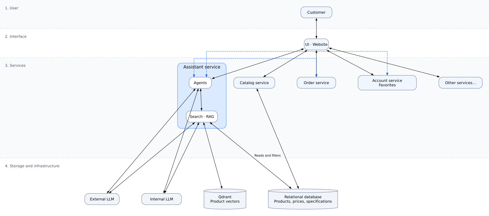
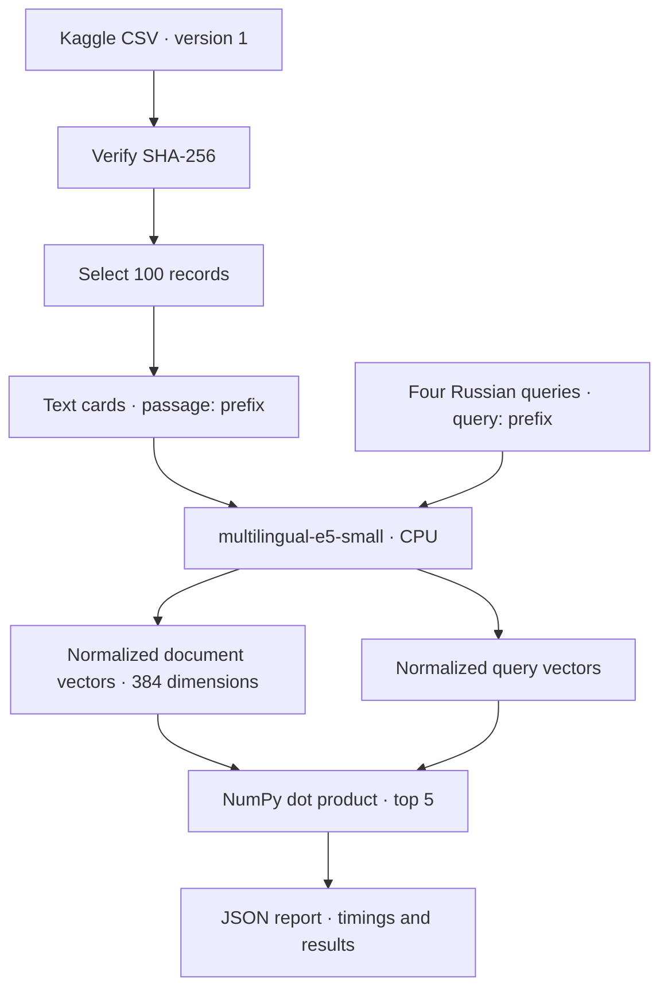

# Smartphone Shopping Assistant

[English](README.md) | [Русский](README.ru.md)

A planned chatbot for a smartphone store, helping customers search the catalog
and choose phones using retrieved records. The first interface will use Streamlit.

**Current status:** all 1,816 catalog records have been validated and prepared as
text cards. A local embedding benchmark has been checked on 100 records.
Full-catalog embeddings, Qdrant, the web interface and answer generation are not implemented yet.

## Architecture

The diagram shows the target service architecture. The website calls the assistant,
catalog, order, account and other services through their APIs. The assistant contains
agents and RAG search, with access to Qdrant, a relational database and internal
or external LLMs. Blue dashed arrows show agent calls to the order and account APIs.



The service layer and infrastructure integrations are planned. The current
implementation covers catalog preparation and a local embedding benchmark;
the first version focuses on RAG search, with agents deferred.

### Current implementation

Catalog preparation validates the eight-column schema, required text, positive
integer memory values, positive finite prices and the Yes/No carrier-lock field.
Unknown memory values remain `null`. Original strings are preserved in `raw_fields`.

Stable UUIDs are derived from a neutral catalog identifier and full product name after
Unicode, whitespace and case normalization. Row order and price changes do not
change IDs; model suffixes, memory variants and colors in the name are retained.
Duplicate identities are rejected instead of silently merged.

```text
Local CSV -> validate rows -> cards with stable UUIDs -> catalog.json
```

The output is one ordinary JSON document: an array of cards. Preparation validates
all rows before replacing `var/prepared/catalog.json`. A repeated run replaces
that file; invalid input leaves the previous result unchanged. No snapshots,
manifests or version switches are created. This step computes no embeddings
and makes no database requests.

The benchmark runs as one Python process on CPU. It selects four records for
known query targets and adds other CSV records to make a 100-record sample.
Each text card retains the original name, brand, model, memory, color,
carrier-lock field and price.



For normalized vectors, the dot product gives cosine similarity. Vectors currently
exist only in process memory; they are not saved to a vector database. Model
files remain in the Hugging Face cache for subsequent runs.

### Next stage

The planned application flow is:

```text
Prepared catalog -> local embeddings -> Qdrant
Streamlit -> query embeddings + explicit filters -> Qdrant -> LLM -> answer with sources
```

Docker Compose configuration for Qdrant is prepared; a running database has not
been verified. The answer-generation model still needs to be selected.
Numeric constraints will use metadata filters. This version covers one catalog;
an agent, historical sales and aggregate statistics are outside its scope.

## Data

[Smartphones Price Dataset](https://www.kaggle.com/datasets/juanmerinobermejo/smartphones-price-dataset),
version 1, by Juan Merino. The dataset page identifies PC Componentes as its source
and lists the Apache 2.0 license. Its last update is April 18, 2024.

This dataset was used as the initial catalog for the project and the embedding
benchmark. The CSV is not included in this repository. Download it from the
dataset page linked above and save it locally as `var/raw/smartphones.csv`.

The CSV contains 1,816 records and eight columns: `Smartphone`, `Brand`, `Model`,
`RAM`, `Storage`, `Color`, `Free` and `Final Price`.

- RAM is missing in 483 records; storage is missing in 25.
- No exact duplicate rows were found during inspection.
- `Model` can group different versions; the full `Smartphone` name must be retained.
- Camera, battery, processor and display specifications are absent.
- USD is a project setting. The source currency is unconfirmed; original amounts
  are preserved without conversion and must not be presented as verified USD prices.

The benchmark reads the original CSV from `var/raw/smartphones.csv` and represents
missing memory values as unknown. Prices describe the source dataset, not current offers.

## Stack

| Component | Technology | Status |
| --- | --- | --- |
| Runtime and environment | Python 3.12, uv | Used in the benchmark |
| Embeddings | Sentence Transformers, PyTorch CPU, multilingual-e5-small | Installed and checked |
| Sample ranking | NumPy | Used in the benchmark |
| Code checks | Ruff | Configured and checked |
| Vector database | Qdrant | Client installed; database not created |
| Web interface | Streamlit | Planned |
| Answer generation | LLM | Planned; model not selected |

## Run

The benchmark was checked on Linux with Python 3.12. Install
[uv](https://docs.astral.sh/uv/), then run from the project directory:

```bash
uv sync --locked --dev
```

Download the CSV from the dataset page to `var/raw/smartphones.csv`, then prepare it:

```bash
uv run --locked python -m smartphone_shopping_assistant.prepare
```

The result is `var/prepared/catalog.json`. Each card contains `id`, `text`,
typed characteristics, `price` and unmodified `raw_fields`.
`currency_status=user_selected`, `source_currency=null` and
`conversion_applied=false` distinguish the project setting from the source currency.
Use `--input /path/to/file.csv --output /path/to/catalog.json` for other local paths.

Run the separate embedding benchmark:

```bash
uv run --locked python scripts/benchmark_embeddings.py
```

The benchmark reads the existing local CSV without downloading or modifying it.
The first model setup downloads approximately 0.5 GB of model and tokenizer files.
The model revision and CSV checksum are pinned in the script.

The script uses two CPU threads, a batch size of 16 and normalized embeddings.
Documents receive `passage:` and questions receive `query:`, following the
[model instructions](https://huggingface.co/intfloat/multilingual-e5-small).
Network access is required only for uncached model files or model-hub metadata;
CSV reading and embedding computation are local. Set `HF_HUB_OFFLINE=1` to use
the cached model without network access. The script does not start Qdrant or generate LLM answers.

## Benchmark results

Initial local measurement on November 26, 2026, Moscow time
(saved locally as `var/benchmarks/embedding-sample-initial.json`):

| Measurement | Result |
| --- | --- |
| 100 cards, three runs | 3.15 s / 3.08 s / 3.21 s |
| Single-query embedding, median of 20 measurements | 12.8 ms |
| Single-query embedding, p95 | 17.4 ms |
| Peak process RSS | 873 MiB |
| Fresh process: imports + cached model load + one query | 14.8 s |
| Expected model ranked first | 4 of 4 sample queries |

The fresh-process check used cached model files with Hugging Face offline mode.
The four queries have known matches in the selected sample. These results check
timing and functionality, not general retrieval quality. Query times exclude
DB retrieval and answer generation. Full-catalog processing time in the report
is a linear estimate, not a measured import.

The script writes `var/benchmarks/embedding-sample.json`: sample names, model
revision, source checksum, timings and top-five results.

## Files and checks

| Path | Purpose |
| --- | --- |
| [scripts/benchmark_embeddings.py](scripts/benchmark_embeddings.py) | Local CSV reading and sample benchmark |
| [src/smartphone_shopping_assistant/prepare.py](src/smartphone_shopping_assistant/prepare.py) | CSV validation, stable IDs and JSON preparation |
| [tests/test_prepare.py](tests/test_prepare.py) | Validation, identity stability and repeatability tests |
| [pyproject.toml](pyproject.toml) | Dependencies and code-check configuration |
| [uv.lock](uv.lock) | Locked dependency versions |
| `var/raw/` | Downloaded source CSV; excluded from Git |
| `var/benchmarks/` | Local reports; excluded from Git |
| `var/prepared/` | Prepared catalog.json; excluded from Git |

```bash
uv run --locked ruff check scripts src tests
uv run --locked ruff format --check scripts src tests
uv lock --check
uv run --locked pytest -q
```

The benchmark checks vector dimensions, finite values and unit norms.
Preparation tests cover missing values, invalid numbers, duplicate identities,
stable IDs, repeated runs and preservation of the output file on validation failure.
Source data, model weights, local reports and the Python environment are excluded from Git.
