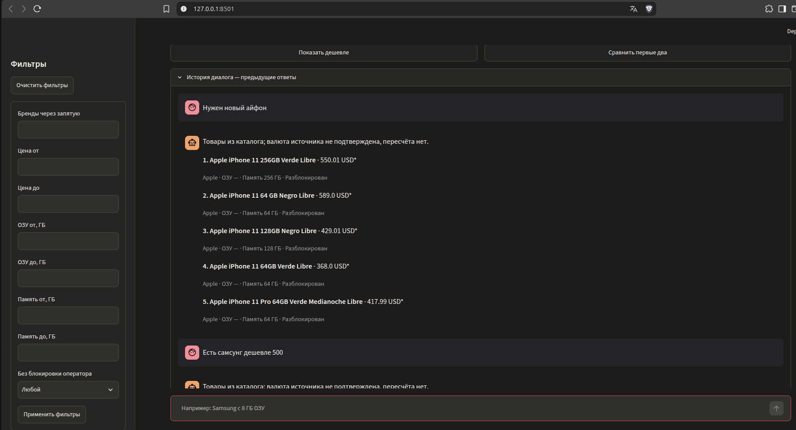
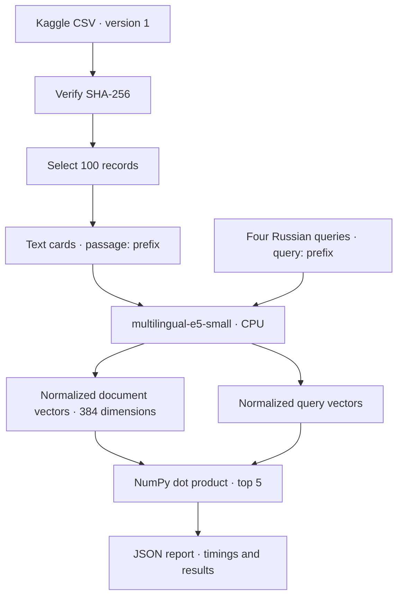

# Smartphone Shopping Assistant

[English](README.md) | [Русский](README.ru.md)

A local smartphone catalog assistant with a Streamlit chat interface. It combines
PostgreSQL filters, E5/Qdrant retrieval and selection by an installed Ollama model.

**Current status:** all 1,816 catalog records are loaded into PostgreSQL and Qdrant
with matching UUIDs. Text and sidebar filters, dialogue refinement and product
comparison are implemented. Local acceptance passed: 121 tests, the live browser
scenarios and paired retrieval/LLM evaluation. This is a local demo; production
deployment has not been tested.

## Interface



Dialogue history and catalog results in the local Streamlit interface. Prices are
historical; the source currency is unconfirmed.

## Architecture

The diagram shows the target service architecture. The website calls the assistant,
catalog, order, account and other services through their APIs. The assistant contains
agents and RAG search, with access to Qdrant, a relational database and internal
or external LLMs. Blue dashed arrows show agent calls to the order and account APIs.


The diagram describes future service boundaries. The current local application
implements catalog preparation, ingestion, filtered retrieval and dialogue.
Order/account integrations and autonomous agents are deferred.

### Current implementation

Catalog preparation validates the eight-column schema, required text, positive
integer memory values, positive finite prices and the Yes/No carrier-lock field.
Unknown memory values remain `null`. Original strings are preserved in `raw_fields`.

Stable UUIDs are derived from a neutral catalog identifier and full product name after
Unicode, whitespace and case normalization. Row order and price changes do not
change IDs; model suffixes, memory variants and colors in the name are retained.
Duplicate identities are rejected instead of silently merged.

```text
Local CSV -> validate rows -> cards with stable UUIDs -> catalog.json
```

The output is one ordinary JSON document: an array of cards. Preparation validates
all rows before replacing `var/prepared/catalog.json`. A repeated run replaces
that file; invalid input leaves the previous result unchanged. No snapshots,
manifests or version switches are created. This step computes no embeddings
and makes no database requests.

The benchmark runs as one Python process on CPU. It selects four records for
known query targets and adds other CSV records to make a 100-record sample.
Each text card retains the original name, brand, model, memory, color,
carrier-lock field and price.



For normalized vectors, the dot product gives cosine similarity. The benchmark
keeps its sample vectors in process memory; the separate ingestion command below
stores full-catalog vectors in Qdrant. Model files remain in the Hugging Face cache.

### Current application flow

```text
Streamlit -> local intent parsing + filter merge -> PostgreSQL candidate UUIDs
E5 query + UUIDs -> Qdrant (20) -> PostgreSQL cards -> LLM selection (10 -> 5)
Selected UUIDs -> PostgreSQL recheck -> answer or comparison
```

The model selects validated catalog IDs; the application displays database facts.
Comparisons read current product rows without running vector retrieval again.
This version uses one catalog and an installed local `qwen3:1.7b` model.
Cross-Encoders, external LLM providers, autonomous agents and sales statistics
are deferred.

## Data

[Smartphones Price Dataset](https://www.kaggle.com/datasets/juanmerinobermejo/smartphones-price-dataset),
version 1, by Juan Merino. The dataset page identifies PC Componentes as its source
and lists the Apache 2.0 license. Its last update is April 18, 2024.

This dataset was used as the initial catalog for the project and the embedding
benchmark. The CSV is not included in this repository. Download it from the
dataset page linked above and save it locally as `var/raw/smartphones.csv`.

The CSV contains 1,816 records and eight columns: `Smartphone`, `Brand`, `Model`,
`RAM`, `Storage`, `Color`, `Free` and `Final Price`.

- RAM is missing in 483 records; storage is missing in 25.
- No exact duplicate rows were found during inspection.
- `Model` can group different versions; the full `Smartphone` name must be retained.
- Camera, battery, processor and display specifications are absent.
- USD is a project setting. The source currency is unconfirmed; original amounts
  are preserved without conversion and must not be presented as verified USD prices.

The benchmark reads the original CSV from `var/raw/smartphones.csv` and represents
missing memory values as unknown. Prices describe the source dataset, not current offers.

## Stack

| Component | Technology | Status |
| --- | --- | --- |
| Runtime and environment | Python 3.12, uv | Used in the benchmark |
| Embeddings | Sentence Transformers, PyTorch CPU, multilingual-e5-small | Full catalog encoded locally |
| Sample ranking | NumPy | Used in the benchmark |
| Code checks | Ruff | Configured and checked |
| Relational database | PostgreSQL 18.7 | Running locally; SQL access and persistence verified |
| Vector database | Qdrant 1.20.2 | Running locally; API, search and persistence verified |
| Web interface | Streamlit | Local browser scenarios verified |
| Final selection | Local Ollama qwen3:1.7b | Local evaluation passed; see the limits below |

## Run

The benchmark was checked on Linux with Python 3.12. Install
[uv](https://docs.astral.sh/uv/), then run from the project directory:

```bash
uv sync --locked --dev
```

### Local shopping assistant

After ingesting the local catalog into PostgreSQL and Qdrant, run the already
installed Ollama model `qwen3:1.7b` locally (no model download is part of this
project setup), then start the UI:

```bash
uv run --locked streamlit run app.py --server.address 127.0.0.1 --server.port 8501
```

Open http://127.0.0.1:8501. Search and refine in chat; apply explicit brand,
price, RAM, storage and unlocked filters in the sidebar. The buttons can request
cheaper results or compare the first two results. The UI uses only catalog facts
read from PostgreSQL. Unknown memory is shown as a dash. USD is the project
currency; the source currency is unconfirmed and no conversion is performed.
Model, database or Qdrant failures produce a fresh error response. Local model
latency has no measured UI guarantee yet; each dialogue call has a 120 s deadline.
Cross Encoders, external LLM, orders and favorites are deferred.

For the same 30 catalog-derived cases, compare retrieval with local selection:

```bash
uv run --locked python -m smartphone_shopping_assistant.evaluation --llm
```

The local `var/evaluation/report.md` contains both modes, model/options, cold/warm
latency, RSS, errors and threshold checks. Queries and report remain untracked.
Unsupported attributes are handled as clarification by the dialogue; they have
no relevance labels in retrieval evaluation.

Local verification on November 27, 2026: 121 tests (including isolated integration
checks), Ruff, formatting, lock verification and an offline build passed. A live UI
scenario covered text search, refinement, sidebar filters, comparison, empty and
unsupported requests, and recovery after a Qdrant outage.

The paired evaluation ran 30 cases (29 distinct query strings), with zero errors,
filter violations or false empty results. On 24 positive labeled cases, nDCG@5
was 0.928 for retrieval and 0.958 after local LLM selection. Warm retrieval-plus-
selection latency was p50 15.8 s / p95 23.3 s; UI intent parsing is additional.
The sample is small and partially judged, so these results do not establish general
recommendation quality. Raw cases, model responses and reports remain local.

### Local PostgreSQL

PostgreSQL is configured in `docker-compose.yml` using `postgres:18.7-bookworm`.
The host endpoint is `127.0.0.1:5432`; the database and user default to `smartphones`.
Other Compose services connect to `postgres:5432`.

Before starting containers, copy `.env.example` to `.env` if you do not already
have a local `.env`, then set a nonempty `POSTGRES_PASSWORD`. You can also change
`POSTGRES_DB`, `POSTGRES_USER` and `POSTGRES_PORT` there. `.env` is excluded from Git.

```bash
test -f .env || cp .env.example .env
# Set POSTGRES_PASSWORD in .env before continuing.
docker compose config --quiet
docker compose up -d --wait postgres
docker compose exec postgres sh -c 'psql -U "$POSTGRES_USER" -d "$POSTGRES_DB" -c "SELECT 1;"'
```

The healthcheck uses `pg_isready`. Data is stored locally in `var/postgres/`,
which is excluded from Git; PostgreSQL 18 mounts it at `/var/lib/postgresql`.
Database initialization settings apply when the data directory is empty;
changing `.env` later does not update existing database credentials.
See the [official image documentation](https://github.com/docker-library/docs/blob/master/postgres/README.md).

Local verification passed: the container is healthy, SQL access works over TCP
with password authentication, and a probe record survived container recreation.
The infrastructure probe schema was removed afterward. Catalog ingestion creates
`public.products`; the application reads it for exact filters and current product facts.

### Local Qdrant

Qdrant runs in Docker at `http://127.0.0.1:6333` using `qdrant/qdrant:v1.20.2`.
With `.env` configured as above, start the service and check readiness and collections:

```bash
docker compose up -d qdrant
curl --fail --silent --show-error http://127.0.0.1:6333/readyz
curl --fail --silent --show-error http://127.0.0.1:6333/collections
```

Data is stored in `var/qdrant/storage/`, mounted at `/qdrant/storage` and excluded
from Git. Local verification covered `/healthz`, `/readyz`, writing and reading
three synthetic 3-dimensional vectors with payloads, and nearest-neighbor search.
The records and search results survived container recreation. The test collection
was deleted afterward; the full catalog is stored separately in `smartphones`.

### Catalog preparation and embedding benchmark

Download the CSV from the dataset page to `var/raw/smartphones.csv`, then prepare it:

```bash
uv run --locked python -m smartphone_shopping_assistant.prepare
```

The result is `var/prepared/catalog.json`. Each card contains `id`, `text`,
typed characteristics, `price` and unmodified `raw_fields`.
`currency_status=user_selected`, `source_currency=null` and
`conversion_applied=false` distinguish the project setting from the source currency.
Use `--input /path/to/file.csv --output /path/to/catalog.json` for other local paths.

### Load the catalog into PostgreSQL and Qdrant

Start both databases as described above. Prepare `var/prepared/catalog.json`
and cache the pinned model using the embedding benchmark below, then run:

```bash
uv run --locked python -m smartphone_shopping_assistant.ingest
```

The command reads `.env`; environment variables override the file. In addition
to the PostgreSQL settings above, `POSTGRES_HOST` defaults to `127.0.0.1` and
`QDRANT_URL` defaults to `http://127.0.0.1:6333`. `--input /path/to/catalog.json`
selects another prepared catalog. Ingestion uses the cached model offline.

All cards are validated before connections are opened. All normalized
384-dimensional embeddings are computed and checked before catalog writes.
Cards receive the `passage: ` prefix and use the benchmark's pinned model revision.

`public.products` stores all prepared fields with UUID as primary key. Prices
use PostgreSQL `NUMERIC` and Python `Decimal` from the original `raw_fields`
price string; missing RAM/storage stay `NULL`. The table is initialized by the
packaged `products.sql`; incompatible existing schemas are rejected.

The Qdrant collection `smartphones` uses 384-dimensional Cosine vectors with
the same UUIDs. Payloads hold the card text, model name and revision; numerical
characteristics remain in PostgreSQL. Writes use upsert, so reruns update existing
records. Extra IDs, incompatible vector settings or a different model revision
cause an error; the loader does not delete products or recreate collections.

PostgreSQL writes commit in one transaction, followed by Qdrant uploads. These
stores have no shared transaction: an interrupted Qdrant upload can leave a
partial result. The command reports failure; rerun the same command to repair it.
Success requires matching ID sets/counts, all stored product values, payloads,
vectors and a technical nearest-neighbor search check.

Local full-catalog verification on November 27, 2026: both databases contain
1,816 records with identical UUID sets. Two complete ingestion runs took 195.19 s
and 86.40 s; model loading and encoding accounted for 192.07 s and 84.71 s.
These are individual local measurements, not a throughput benchmark. Complete
stored content matched after the rerun. All prices and raw fields matched the
source CSV; 483 missing RAM values and 25 missing storage values remained `NULL`.
Technical search checks do not measure general retrieval quality.

### Separate embedding benchmark

Run the separate embedding benchmark:

```bash
uv run --locked python scripts/benchmark_embeddings.py
```

The benchmark reads the existing local CSV without downloading or modifying it.
The first model setup downloads approximately 0.5 GB of model and tokenizer files.
The model revision and CSV checksum are pinned in the script.

The script uses two CPU threads, a batch size of 16 and normalized embeddings.
Documents receive `passage:` and questions receive `query:`, following the
[model instructions](https://huggingface.co/intfloat/multilingual-e5-small).
Network access is required only for uncached model files or model-hub metadata;
CSV reading and embedding computation are local. Set `HF_HUB_OFFLINE=1` to use
the cached model without network access. The script does not start Qdrant or generate LLM answers.

## Benchmark results

Initial local measurement on November 26, 2026, Moscow time
(saved locally as `var/benchmarks/embedding-sample-initial.json`):

| Measurement | Result |
| --- | --- |
| 100 cards, three runs | 3.15 s / 3.08 s / 3.21 s |
| Single-query embedding, median of 20 measurements | 12.8 ms |
| Single-query embedding, p95 | 17.4 ms |
| Peak process RSS | 873 MiB |
| Fresh process: imports + cached model load + one query | 14.8 s |
| Expected model ranked first | 4 of 4 sample queries |

The fresh-process check used cached model files with Hugging Face offline mode.
The four queries have known matches in the selected sample. These results check
timing and functionality, not general retrieval quality. Query times exclude
DB retrieval and answer generation. Full-catalog processing time in the report
is a linear estimate, not a measured import.

The script writes `var/benchmarks/embedding-sample.json`: sample names, model
revision, source checksum, timings and top-five results.

## Files and checks

| Path | Purpose |
| --- | --- |
| [scripts/benchmark_embeddings.py](scripts/benchmark_embeddings.py) | Local CSV reading and sample benchmark |
| [src/smartphone_shopping_assistant/prepare.py](src/smartphone_shopping_assistant/prepare.py) | CSV validation, stable IDs and JSON preparation |
| [src/smartphone_shopping_assistant/ingest.py](src/smartphone_shopping_assistant/ingest.py) | Offline embeddings, upserts and cross-store verification |
| [src/smartphone_shopping_assistant/products.sql](src/smartphone_shopping_assistant/products.sql) | Initial product table schema |
| [tests/test_ingest.py](tests/test_ingest.py) | Synthetic validation and collection compatibility checks |
| [tests/test_ingest_integration.py](tests/test_ingest_integration.py) | Opt-in PostgreSQL rollback, interrupted upload and rerun checks |
| [tests/test_prepare.py](tests/test_prepare.py) | Validation, identity stability and repeatability tests |
| [app.py](app.py) | Streamlit chat, filters, product cards and comparison |
| [src/smartphone_shopping_assistant/dialogue.py](src/smartphone_shopping_assistant/dialogue.py) | Session state, refinement and comparison service |
| [src/smartphone_shopping_assistant/search.py](src/smartphone_shopping_assistant/search.py) | PostgreSQL-filtered Qdrant retrieval |
| [src/smartphone_shopping_assistant/llm.py](src/smartphone_shopping_assistant/llm.py) | Bounded local intent parsing and candidate selection |
| [src/smartphone_shopping_assistant/evaluation.py](src/smartphone_shopping_assistant/evaluation.py) | Paired local evaluation and metrics |
| [pyproject.toml](pyproject.toml) | Dependencies and code-check configuration |
| [uv.lock](uv.lock) | Locked dependency versions |
| `var/raw/` | Downloaded source CSV; excluded from Git |
| `var/benchmarks/` | Local reports; excluded from Git |
| `var/prepared/` | Prepared catalog.json; excluded from Git |

```bash
uv run --locked ruff check app.py scripts src tests
uv run --locked ruff format --check app.py scripts src tests
uv lock --check
uv run --locked pytest -q
```

The benchmark checks vector dimensions, finite values and unit norms.
Preparation tests cover missing values, invalid numbers, duplicate identities,
stable IDs, repeated runs and preservation of the output file on validation failure.
Source data, model weights, local reports and the Python environment are excluded from Git.

To also run the PostgreSQL integration tests, use the local `.env` and a database
user with permission to create databases:

```bash
SSA_RUN_INTEGRATION=1 uv run --locked pytest -q
```

These tests create and remove disposable `ssa_ingest_test_*` databases and use
synthetic cards with an in-memory Qdrant client. They do not modify the catalog
databases. Full-catalog loading is verified separately against the running services.
