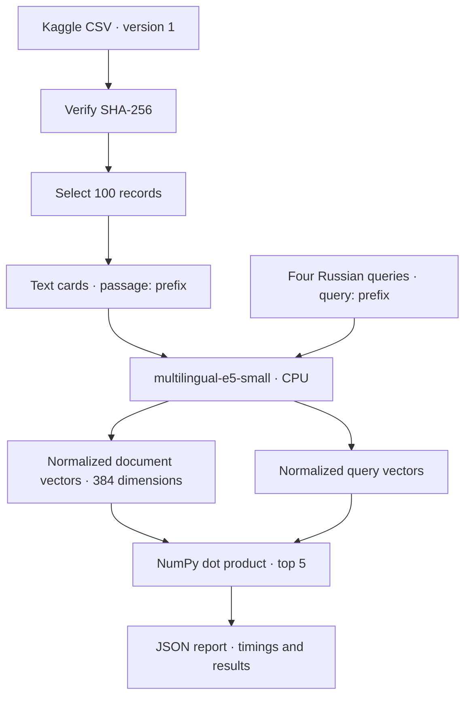

# Smartphone Catalog RAG

[English](README.md) | [Русский](README.ru.md)

A project for searching a smartphone catalog and answering questions using
retrieved records. The first interface will use Streamlit.

**Current status:** a local embedding benchmark is implemented and checked on
100 records. Full-catalog ingestion, Qdrant, the web interface and answer
generation are not implemented yet.

## Architecture

The benchmark runs as one Python process on CPU. It selects four records for
known query targets and adds other CSV records to make a 100-record sample.
Each text card retains the original name, brand, model, memory, color,
carrier-lock field and price.



For normalized vectors, the dot product gives cosine similarity. Vectors currently
exist only in process memory; they are not saved to a vector database. Model
files remain in the Hugging Face cache for subsequent runs.

### Next stage

The planned application flow is:

```text
CSV -> validated cards -> local embeddings -> Qdrant
Streamlit -> query embeddings + explicit filters -> Qdrant -> LLM -> answer with sources
```

The Qdrant deployment mode and answer-generation model still need to be selected.
Numeric constraints will use metadata filters. This version covers one catalog;
an agent, historical sales and aggregate statistics are outside its scope.

## Data

[Smartphones Price Dataset](https://www.kaggle.com/datasets/juanmerinobermejo/smartphones-price-dataset),
version 1, by Juan Merino. The dataset page identifies PC Componentes as its source
and lists the Apache 2.0 license. Its last update is April 18, 2024.

The CSV contains 1,816 records and eight columns: `Smartphone`, `Brand`, `Model`,
`RAM`, `Storage`, `Color`, `Free` and `Final Price`.

- RAM is missing in 483 records; storage is missing in 25.
- No exact duplicate rows were found during inspection.
- `Model` can group different versions; the full `Smartphone` name must be retained.
- Camera, battery, processor and display specifications are absent.
- USD is a project setting. The source currency is unconfirmed; original amounts
  are preserved without conversion and must not be presented as verified USD prices.

The benchmark saves the original CSV to `var/raw/smartphones.csv` and represents
missing memory values as unknown. Prices describe the source dataset, not current offers.

## Stack

| Component | Technology | Status |
| --- | --- | --- |
| Runtime and environment | Python 3.12, uv | Used in the benchmark |
| Embeddings | Sentence Transformers, PyTorch CPU, multilingual-e5-small | Installed and checked |
| Sample ranking | NumPy | Used in the benchmark |
| Code checks | Ruff | Configured and checked |
| Vector database | Qdrant | Client installed; database not created |
| Web interface | Streamlit | Planned |
| Answer generation | LLM | Planned; model not selected |

## Run

The benchmark was checked on Linux with Python 3.12. Install
[uv](https://docs.astral.sh/uv/), then run from the project directory:

```bash
uv sync --locked --dev
uv run --locked python scripts/benchmark_embeddings.py
```

The first run downloads the CSV and approximately 0.5 GB of model and tokenizer
files. No Kaggle account was required for the checked public dataset download.
The model revision and CSV checksum are pinned in the script.

The script uses two CPU threads, a batch size of 16 and normalized embeddings.
Documents receive `passage:` and questions receive `query:`, following the
[model instructions](https://huggingface.co/intfloat/multilingual-e5-small).
Network access is required for Kaggle and for uncached model files; embedding
computation is local. The script does not start Qdrant or generate LLM answers.

## Benchmark results

Measured locally on November 26, 2026, Moscow time:

| Measurement | Result |
| --- | --- |
| 100 cards, three runs | 3.15 s / 3.08 s / 3.21 s |
| Single-query embedding, median of 20 measurements | 12.8 ms |
| Single-query embedding, p95 | 17.4 ms |
| Peak process RSS | 873 MiB |
| Fresh process: imports + cached model load + one query | 14.8 s |
| Expected model ranked first | 4 of 4 sample queries |

The fresh-process check used cached model files with Hugging Face offline mode.
The four queries have known matches in the selected sample. These results check
timing and functionality, not general retrieval quality. Query times exclude
DB retrieval and answer generation. Full-catalog processing time in the report
is a linear estimate, not a measured import.

The script writes `var/benchmarks/embedding-sample.json`: sample names, model
revision, source checksum, timings and top-five results.

## Files and checks

| Path | Purpose |
| --- | --- |
| [scripts/benchmark_embeddings.py](scripts/benchmark_embeddings.py) | Download and sample benchmark |
| [src/rag_phones/](src/rag_phones/) | Package scaffold for subsequent implementation |
| [pyproject.toml](pyproject.toml) | Dependencies and code-check configuration |
| [uv.lock](uv.lock) | Locked dependency versions |
| `var/raw/` | Downloaded source CSV; excluded from Git |
| `var/benchmarks/` | Local reports; excluded from Git |

```bash
uv run --locked ruff check scripts src
uv run --locked ruff format --check scripts src
uv lock --check
```

The benchmark checks vector dimensions, finite values and unit norms.
There is no automated test suite yet. Source data, model weights, local reports
and the Python environment are excluded from Git.
