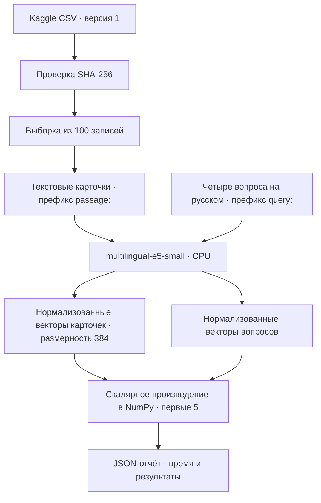

# RAG по каталогу смартфонов

[English](README.md) | [Русский](README.ru.md)

Проект для поиска по каталогу смартфонов и ответов с опорой на найденные
записи. Для первого интерфейса выбран Streamlit.

**Текущее состояние:** реализован и проверен локальный замер эмбеддингов на
100 записях. Полный импорт каталога, Qdrant, веб-интерфейс и генерация ответов
пока не реализованы.

## Архитектура

Замер выполняется одним Python-процессом на CPU. Скрипт выбирает четыре записи
для проверочных вопросов и дополняет выборку другими строками CSV до 100 записей.
Текстовые карточки сохраняют исходное название, бренд, модель, память, цвет,
признак привязки к оператору и цену.



Для нормализованных векторов скалярное произведение равно косинусной близости.
Сейчас векторы находятся только в памяти процесса и не сохраняются в векторную
базу. Файлы модели остаются в кеше Hugging Face для следующих запусков.

### Следующий этап

Планируемая схема приложения:

```text
CSV -> проверенные карточки -> локальные эмбеддинги -> Qdrant
Streamlit -> вектор вопроса + явные фильтры -> Qdrant -> LLM -> ответ с источниками
```

Режим запуска Qdrant и модель генерации ответов ещё предстоит выбрать.
Числовые ограничения будут применяться фильтрами метаданных. Первая версия
работает с одним каталогом; агент, исторические продажи и агрегатная статистика
в её область не входят.

## Данные

[Smartphones Price Dataset](https://www.kaggle.com/datasets/juanmerinobermejo/smartphones-price-dataset),
версия 1, автор Juan Merino. На странице датасета источником указан PC Componentes,
лицензия — Apache 2.0. Последнее обновление — 18 апреля 2024 года.

CSV содержит 1 816 записей и восемь столбцов: `Smartphone`, `Brand`, `Model`,
`RAM`, `Storage`, `Color`, `Free` и `Final Price`.

- RAM отсутствует в 483 записях, объём накопителя — в 25.
- При проверке полных дубликатов строк не обнаружено.
- `Model` может объединять разные версии; полное название `Smartphone` сохраняется.
- Характеристик камеры, аккумулятора, процессора и экрана нет.
- USD — настройка проекта. Валюта источника не подтверждена; исходные суммы
  сохраняются без пересчёта и не должны выдаваться за подтверждённые цены в USD.

Скрипт замера сохраняет исходный CSV в `var/raw/smartphones.csv` и отмечает
пропущенные значения памяти как неизвестные. Цены относятся к исходному набору,
а не к текущим предложениям магазинов.

## Стек

| Компонент | Технология | Состояние |
| --- | --- | --- |
| Среда выполнения и зависимости | Python 3.12, uv | Используются в замере |
| Эмбеддинги | Sentence Transformers, PyTorch CPU, multilingual-e5-small | Установлены и проверены |
| Ранжирование выборки | NumPy | Используется в замере |
| Проверка кода | Ruff | Настроена и выполнена |
| Векторная база | Qdrant | Клиент установлен; база не создана |
| Веб-интерфейс | Streamlit | Запланирован |
| Генерация ответов | LLM | Запланирована; модель не выбрана |

## Запуск

Замер проверен на Linux с Python 3.12. Установите
[uv](https://docs.astral.sh/uv/), затем из каталога проекта выполните:

```bash
uv sync --locked --dev
uv run --locked python scripts/benchmark_embeddings.py
```

Первый запуск скачивает CSV и около 0,5 ГБ файлов модели и токенизатора.
При проверенном скачивании публичного датасета аккаунт Kaggle не потребовался.
Ревизия модели и контрольная сумма CSV зафиксированы в скрипте.

Скрипт использует два потока CPU, batch size 16 и нормализованные эмбеддинги.
Карточки получают `passage:`, вопросы — `query:` согласно
[инструкции модели](https://huggingface.co/intfloat/multilingual-e5-small).
Для Kaggle и отсутствующих в кеше файлов модели нужен интернет; вычисление
эмбеддингов выполняется локально. Скрипт не запускает Qdrant и не генерирует ответы LLM.

## Результаты замера

Локальный замер 26 ноября 2026 года по московскому времени:

| Проверка | Результат |
| --- | --- |
| 100 карточек, три прогона | 3,15 с / 3,08 с / 3,21 с |
| Эмбеддинг одного вопроса, медиана 20 измерений | 12,8 мс |
| Эмбеддинг одного вопроса, p95 | 17,4 мс |
| Пиковая память процесса, RSS | 873 МиБ |
| Новый процесс: импорты + загрузка из кеша + один вопрос | 14,8 с |
| Ожидаемая модель найдена первой | 4 из 4 проверочных вопросов |

Проверка нового процесса использовала кеш модели и офлайн-режим Hugging Face.
Для четырёх вопросов в выборку заведомо включены соответствующие записи.
Результаты подтверждают скорость и выполнение примера, но не общее качество поиска.
Время вопроса не включает обращение к базе и генерацию ответа. Время обработки
полного каталога в отчёте — линейная оценка, а не результат полного импорта.

Скрипт записывает `var/benchmarks/embedding-sample.json`: состав выборки,
ревизию модели, контрольную сумму CSV, времена и первые пять результатов поиска.

## Файлы и проверки

| Путь | Назначение |
| --- | --- |
| [scripts/benchmark_embeddings.py](scripts/benchmark_embeddings.py) | Скачивание данных и замер на выборке |
| [src/rag_phones/](src/rag_phones/) | Каркас пакета для последующей реализации |
| [pyproject.toml](pyproject.toml) | Зависимости и настройки проверки кода |
| [uv.lock](uv.lock) | Зафиксированные версии зависимостей |
| `var/raw/` | Исходный CSV; исключён из Git |
| `var/benchmarks/` | Локальные отчёты; исключены из Git |

```bash
uv run --locked ruff check scripts src
uv run --locked ruff format --check scripts src
uv lock --check
```

Скрипт проверяет размерность векторов, отсутствие неконечных значений и единичную норму.
Набора автоматических тестов пока нет. Исходные данные, веса модели, локальные
отчёты и Python-окружение исключены из Git.
