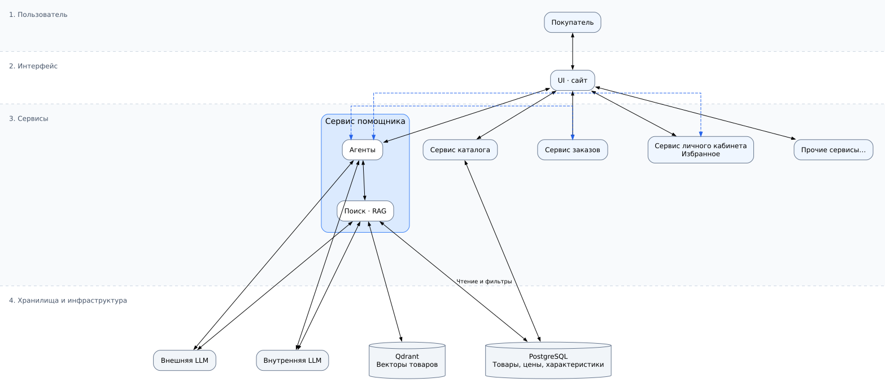
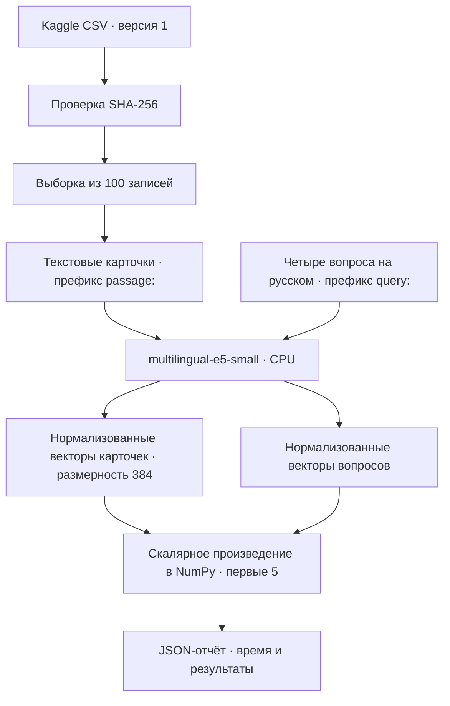

# Smartphone Shopping Assistant

[English](README.md) | [Русский](README.ru.md)

Локальный помощник по каталогу смартфонов с чатом на Streamlit. Сочетает
фильтры PostgreSQL, поиск E5/Qdrant и отбор установленной моделью Ollama.

**Текущее состояние:** все 1 816 записей каталога загружены в PostgreSQL и Qdrant
с совпадающими UUID. Реализованы текстовые и явные фильтры, уточнения диалога
и сравнение товаров. Локальная приёмка пройдена: 121 тест, живые браузерные
сценарии и парная оценка поиска/LLM. Это локальное демо; внедрение
в рабочую среду не проверялось.

## Архитектура

Схема показывает целевую архитектуру сервисов. Сайт обращается к помощнику,
каталогу, заказам, личному кабинету и прочим сервисам через их API. Помощник
содержит агентов и RAG-поиск с доступом к Qdrant, реляционной БД, внутренней
или внешней LLM. Голубые пунктирные стрелки — вызовы агентами API заказов и личного кабинета.



Схема описывает будущие границы сервисов. В локальном приложении реализованы
подготовка, загрузка каталога, поиск с фильтрами и диалог. Интеграции заказов
и личного кабинета, а также автономные агенты отложены.

### Текущая реализация

Подготовка каталога проверяет схему из восьми столбцов, обязательные текстовые
поля, положительные целые значения памяти, положительные конечные цены
и признак Yes/No для привязки к оператору. Пропуски памяти остаются `null`.
Исходные строки полей сохраняются в `raw_fields`.

Стабильный UUID строится из нейтрального имени каталога и полного названия позиции
после нормализации Unicode, пробелов и регистра. Перестановка строк и изменение
цены не меняют ID; суффиксы модели, варианты памяти и цвета в названии сохраняются.
Повторяющиеся идентификаторы отвергаются, а не объединяются автоматически.

```text
Локальный CSV -> проверка строк -> карточки со стабильными UUID -> catalog.json
```

Результат — один обычный JSON-документ: массив карточек. Скрипт проверяет
все строки перед заменой `var/prepared/catalog.json`. Повторный запуск заменяет
этот файл; при ошибке входных данных предыдущий результат сохраняется.
Снимки, манифесты и переключатели версий не создаются. На этом шаге эмбеддинги
не вычисляются, обращений к базе нет.

Замер выполняется одним Python-процессом на CPU. Скрипт выбирает четыре записи
для проверочных вопросов и дополняет выборку другими строками CSV до 100 записей.
Текстовые карточки сохраняют исходное название, бренд, модель, память, цвет,
признак привязки к оператору и цену.



Для нормализованных векторов скалярное произведение равно косинусной близости.
Скрипт замера хранит векторы выборки в памяти процесса; отдельная команда
загрузки ниже сохраняет векторы полного каталога в Qdrant. Файлы модели остаются
в кеше Hugging Face для следующих запусков.

### Текущий поток приложения

```text
Streamlit -> локальный разбор намерения + фильтры -> UUID из PostgreSQL
Вектор E5 + UUID -> Qdrant (20) -> карточки PostgreSQL -> отбор LLM (10 -> 5)
Выбранные UUID -> повторная проверка PostgreSQL -> ответ или сравнение
```

Модель выбирает проверяемые ID каталога, а приложение показывает факты из БД.
Сравнение читает текущие записи товаров без повторного векторного поиска.
Версия работает с одним каталогом и установленной локальной `qwen3:1.7b`.
Cross-Encoder, внешние LLM, автономные агенты и статистика продаж отложены.

## Данные

[Smartphones Price Dataset](https://www.kaggle.com/datasets/juanmerinobermejo/smartphones-price-dataset),
версия 1, автор Juan Merino. На странице датасета источником указан PC Componentes,
лицензия — Apache 2.0. Последнее обновление — 18 апреля 2024 года.

Датасет использован как начальный каталог проекта и источник данных для замера
эмбеддингов. CSV не включён в репозиторий. Его можно скачать со страницы датасета
по ссылке выше и сохранить локально в `var/raw/smartphones.csv`.

CSV содержит 1 816 записей и восемь столбцов: `Smartphone`, `Brand`, `Model`,
`RAM`, `Storage`, `Color`, `Free` и `Final Price`.

- RAM отсутствует в 483 записях, объём накопителя — в 25.
- При проверке полных дубликатов строк не обнаружено.
- `Model` может объединять разные версии; полное название `Smartphone` сохраняется.
- Характеристик камеры, аккумулятора, процессора и экрана нет.
- USD — настройка проекта. Валюта источника не подтверждена; исходные суммы
  сохраняются без пересчёта и не должны выдаваться за подтверждённые цены в USD.

Скрипт замера читает исходный CSV из `var/raw/smartphones.csv` и отмечает
пропущенные значения памяти как неизвестные. Цены относятся к исходному набору,
а не к текущим предложениям магазинов.

## Стек

| Компонент | Технология | Состояние |
| --- | --- | --- |
| Среда выполнения и зависимости | Python 3.12, uv | Используются в замере |
| Эмбеддинги | Sentence Transformers, PyTorch CPU, multilingual-e5-small | Полный каталог обработан локально |
| Ранжирование выборки | NumPy | Используется в замере |
| Проверка кода | Ruff | Настроена и выполнена |
| Реляционная база | PostgreSQL 18.7 | Запущена локально; SQL и сохранение данных проверены |
| Векторная база | Qdrant 1.20.2 | Запущена локально; API, поиск и сохранение данных проверены |
| Веб-интерфейс | Streamlit | Локальные браузерные сценарии проверены |
| Финальный отбор | Локальная Ollama qwen3:1.7b | Локальная оценка пройдена; ограничения указаны ниже |

## Запуск

Замер проверен на Linux с Python 3.12. Установите
[uv](https://docs.astral.sh/uv/), затем из каталога проекта выполните:

```bash
uv sync --locked --dev
```

### Локальный подбор смартфона

После загрузки каталога в PostgreSQL и Qdrant запустите ранее установленную
локальную модель Ollama `qwen3:1.7b` (установка модели в запуск проекта не
входит), затем UI:

```bash
uv run --locked streamlit run app.py --server.address 127.0.0.1 --server.port 8501
```

Откройте http://127.0.0.1:8501. В чате доступны поиск и уточнение; в боковой
панели — явные фильтры бренда, цены, ОЗУ, памяти и блокировки оператора.
Кнопки запрашивают более дешёвые товары и сравнение первых двух позиций.
Факты о товарах читаются из PostgreSQL; неизвестная память отмечена прочерком.
USD — валюта проекта, исходная валюта не подтверждена, пересчёта нет.
При ошибке модели или хранилищ показывается новый ответ об ошибке.
Гарантии задержки UI пока нет; deadline вызова диалога — 120 секунд.
Cross-Encoder, внешняя LLM, заказы и избранное отложены.

Сравнение базового поиска и локального отбора на одних 30 запросах:

```bash
uv run --locked python -m smartphone_shopping_assistant.evaluation --llm
```

Локальный `var/evaluation/report.md` содержит оба режима, модель и параметры,
задержки cold/warm, RSS, ошибки и проверку порогов. Запросы и отчёт не
версионируются. Запросы отсутствующих характеристик разбираются диалогом;
для retrieval-оценки их релевантность не размечена.

Локальная проверка 27 ноября 2026 года: прошли 121 тест, включая изолированные
интеграционные проверки, Ruff, форматирование, проверка lock и сборка без сети.
Живой UI-сценарий охватил текстовый поиск, уточнение, фильтры панели, сравнение,
пустой ответ, неизвестные характеристики и восстановление после сбоя Qdrant.

Парная оценка содержит 30 случаев (29 разных формулировок): ошибок, нарушений
фильтров и ложных пустых ответов нет. На 24 положительных размеченных случаях
nDCG@5 составил 0,928 у базового поиска и 0,958 после локального отбора LLM.
Задержка прогретого поиска с отбором: p50 15,8 с / p95 23,3 с; разбор текста UI
добавляется отдельно. Набор мал, разметка частичная: эти показатели не доказывают
общее качество рекомендаций. Исходные запросы, ответы модели и отчёты остаются локальными.

### Локальная PostgreSQL

PostgreSQL настроена в `docker-compose.yml`, образ — `postgres:18.7-bookworm`.
Адрес на хосте — `127.0.0.1:5432`; имя базы и пользователя по умолчанию — `smartphones`.
Другие сервисы Compose подключаются к `postgres:5432`.

Перед запуском контейнеров скопируйте `.env.example` в `.env`, если локального
`.env` ещё нет, и задайте непустой `POSTGRES_PASSWORD`. Там же можно изменить
`POSTGRES_DB`, `POSTGRES_USER` и `POSTGRES_PORT`. `.env` исключён из Git.

```bash
test -f .env || cp .env.example .env
# Задайте POSTGRES_PASSWORD в .env перед следующими командами.
docker compose config --quiet
docker compose up -d --wait postgres
docker compose exec postgres sh -c 'psql -U "$POSTGRES_USER" -d "$POSTGRES_DB" -c "SELECT 1;"'
```

Готовность проверяется через `pg_isready`. Данные хранятся локально в
`var/postgres/`, исключённом из Git; для PostgreSQL 18 он подключается к
`/var/lib/postgresql`. Параметры инициализации применяются при пустом каталоге
данных; последующее изменение `.env` не меняет учётные данные существующей базы.
См. [документацию официального образа](https://github.com/docker-library/docs/blob/master/postgres/README.md).

Локальная проверка пройдена: контейнер healthy, SQL-подключение по TCP работает
с проверкой пароля, тестовая запись сохранилась после пересоздания контейнера.
Проверочная схема инфраструктуры затем удалена. Загрузчик создаёт
`public.products`; приложение читает её для точных фильтров и текущих фактов о товарах.

### Локальная Qdrant

Qdrant работает в Docker по адресу `http://127.0.0.1:6333`, образ — `qdrant/qdrant:v1.20.2`.
После настройки `.env`, описанной выше, запустите сервис и проверьте готовность и коллекции:

```bash
docker compose up -d qdrant
curl --fail --silent --show-error http://127.0.0.1:6333/readyz
curl --fail --silent --show-error http://127.0.0.1:6333/collections
```

Данные хранятся в `var/qdrant/storage/`, подключённом к `/qdrant/storage` и
исключённом из Git. Локально проверены `/healthz`, `/readyz`, запись и чтение
трёх синтетических трёхмерных векторов с метаданными и поиск ближайшего вектора.
Записи и результаты поиска сохранились после пересоздания контейнера.
Тестовая коллекция затем удалена; полный каталог хранится отдельно в `smartphones`.

### Подготовка каталога и замер эмбеддингов

Скачайте CSV со страницы датасета в `var/raw/smartphones.csv` и подготовьте каталог:

```bash
uv run --locked python -m smartphone_shopping_assistant.prepare
```

Результат — `var/prepared/catalog.json`. Каждая карточка содержит `id`, `text`,
типизированные характеристики, `price` и исходные значения `raw_fields`.
Поля `currency_status=user_selected`, `source_currency=null` и
`conversion_applied=false` отличают настройку проекта от валюты источника.
Другие локальные пути задаются через `--input /путь/к/файлу.csv --output /путь/к/catalog.json`.

### Загрузка каталога в PostgreSQL и Qdrant

Запустите обе базы по инструкциям выше. Подготовьте `var/prepared/catalog.json`
и сохраните закреплённую модель в кэш через скрипт замера ниже, затем выполните:

```bash
uv run --locked python -m smartphone_shopping_assistant.ingest
```

Команда читает `.env`; переменные окружения имеют приоритет над файлом.
Помимо настроек PostgreSQL выше, `POSTGRES_HOST` по умолчанию равен `127.0.0.1`,
`QDRANT_URL` — `http://127.0.0.1:6333`. `--input /путь/к/catalog.json` задаёт другой
подготовленный каталог. Модель при загрузке работает из кэша без сетевых обращений.

Все карточки проверяются до подключения к базам. Все нормализованные
384-мерные эмбеддинги вычисляются и проверяются до записи каталога.
Карточки получают префикс `passage: `; ревизия модели совпадает со скриптом замера.

В `public.products` сохраняются все поля карточек, UUID — первичный ключ.
Цена хранится как PostgreSQL `NUMERIC` и Python `Decimal` из исходной строки
цены в `raw_fields`; пропуски RAM и накопителя остаются `NULL`.
Таблица создаётся из включённого в пакет `products.sql`; несовместимая существующая
схема отклоняется.

Коллекция Qdrant `smartphones` содержит 384-мерные векторы с метрикой Cosine
и теми же UUID. В payload сохраняются текст карточки, имя и ревизия модели;
числовые характеристики остаются в PostgreSQL. Upsert обновляет существующие
записи при повторном запуске. Лишние ID, несовместимые настройки векторов
или другая ревизия модели вызывают ошибку; загрузчик не удаляет товары
и не пересоздаёт коллекции автоматически.

Запись PostgreSQL выполняется одной транзакцией, затем загружается Qdrant.
Общей транзакции между базами нет: прерывание загрузки Qdrant может оставить
частичный результат. Команда сообщает об ошибке; повторите её для восстановления.
Успех подтверждается совпадением множеств ID и количества записей, всех полей
товаров, payload и векторов, а также технической проверкой векторного поиска.

Полная локальная проверка 27 ноября 2026 года: в обеих базах по 1816 записей,
множества UUID совпадают. Два полных запуска заняли 195,19 с и 86,40 с;
загрузка модели и вычисление эмбеддингов — 192,07 с и 84,71 с.
Это отдельные локальные измерения, а не оценка пропускной способности.
Полное содержимое баз совпало после повторного запуска. Все цены и исходные
поля сверены с CSV; 483 пропуска RAM и 25 пропусков накопителя остались `NULL`.
Технические проверки поиска не оценивают общее качество подбора товаров.

### Отдельный замер эмбеддингов

Отдельный замер эмбеддингов:

```bash
uv run --locked python scripts/benchmark_embeddings.py
```

Скрипт читает существующий локальный CSV без скачивания и изменения файла.
При первой установке модели скачивается около 0,5 ГБ её файлов и токенизатора.
Ревизия модели и контрольная сумма CSV зафиксированы в скрипте.

Скрипт использует два потока CPU, batch size 16 и нормализованные эмбеддинги.
Карточки получают `passage:`, вопросы — `query:` согласно
[инструкции модели](https://huggingface.co/intfloat/multilingual-e5-small).
Интернет нужен только для отсутствующих в кеше файлов модели или метаданных
модельного хаба; чтение CSV и вычисление эмбеддингов выполняются локально.
С `HF_HUB_OFFLINE=1` используется кеш модели без сетевых обращений. Скрипт не запускает Qdrant и не генерирует ответы LLM.

## Результаты замера

Первоначальный локальный замер 26 ноября 2026 года по московскому времени
(сохранён локально в `var/benchmarks/embedding-sample-initial.json`):

| Проверка | Результат |
| --- | --- |
| 100 карточек, три прогона | 3,15 с / 3,08 с / 3,21 с |
| Эмбеддинг одного вопроса, медиана 20 измерений | 12,8 мс |
| Эмбеддинг одного вопроса, p95 | 17,4 мс |
| Пиковая память процесса, RSS | 873 МиБ |
| Новый процесс: импорты + загрузка из кеша + один вопрос | 14,8 с |
| Ожидаемая модель найдена первой | 4 из 4 проверочных вопросов |

Проверка нового процесса использовала кеш модели и офлайн-режим Hugging Face.
Для четырёх вопросов в выборку заведомо включены соответствующие записи.
Результаты подтверждают скорость и выполнение примера, но не общее качество поиска.
Время вопроса не включает обращение к базе и генерацию ответа. Время обработки
полного каталога в отчёте — линейная оценка, а не результат полного импорта.

Скрипт записывает `var/benchmarks/embedding-sample.json`: состав выборки,
ревизию модели, контрольную сумму CSV, времена и первые пять результатов поиска.

## Файлы и проверки

| Путь | Назначение |
| --- | --- |
| [scripts/benchmark_embeddings.py](scripts/benchmark_embeddings.py) | Чтение локального CSV и замер на выборке |
| [src/smartphone_shopping_assistant/prepare.py](src/smartphone_shopping_assistant/prepare.py) | Проверка CSV, стабильные ID и подготовка JSON |
| [src/smartphone_shopping_assistant/ingest.py](src/smartphone_shopping_assistant/ingest.py) | Офлайн-эмбеддинги, upsert и сверка двух баз |
| [src/smartphone_shopping_assistant/products.sql](src/smartphone_shopping_assistant/products.sql) | Начальная схема таблицы товаров |
| [tests/test_ingest.py](tests/test_ingest.py) | Синтетические проверки данных и совместимости коллекции |
| [tests/test_ingest_integration.py](tests/test_ingest_integration.py) | Откат PostgreSQL, прерывание загрузки и повторный запуск |
| [tests/test_prepare.py](tests/test_prepare.py) | Проверки типов, стабильности ID и повторного запуска |
| [app.py](app.py) | Чат Streamlit, фильтры, карточки и сравнение |
| [src/smartphone_shopping_assistant/dialogue.py](src/smartphone_shopping_assistant/dialogue.py) | Состояние сессии, уточнение и сравнение |
| [src/smartphone_shopping_assistant/search.py](src/smartphone_shopping_assistant/search.py) | Поиск Qdrant с предварительными фильтрами PostgreSQL |
| [src/smartphone_shopping_assistant/llm.py](src/smartphone_shopping_assistant/llm.py) | Ограниченный локальный разбор и отбор кандидатов |
| [src/smartphone_shopping_assistant/evaluation.py](src/smartphone_shopping_assistant/evaluation.py) | Парная локальная оценка и метрики |
| [pyproject.toml](pyproject.toml) | Зависимости и настройки проверки кода |
| [uv.lock](uv.lock) | Зафиксированные версии зависимостей |
| `var/raw/` | Исходный CSV; исключён из Git |
| `var/benchmarks/` | Локальные отчёты; исключены из Git |
| `var/prepared/` | Подготовленный catalog.json; исключён из Git |

```bash
uv run --locked ruff check app.py scripts src tests
uv run --locked ruff format --check app.py scripts src tests
uv lock --check
uv run --locked pytest -q
```

Скрипт проверяет размерность векторов, отсутствие неконечных значений и единичную норму.
Тесты подготовки проверяют пропуски, некорректные числа, дубликаты, стабильность ID,
повторные запуски и сохранение выходного файла при ошибке проверки. Исходные данные,
веса модели, локальные отчёты и Python-окружение исключены из Git.

Для включения интеграционных тестов PostgreSQL используйте локальный `.env`
и пользователя с правом создавать базы:

```bash
SSA_RUN_INTEGRATION=1 uv run --locked pytest -q
```

Тесты создают и удаляют временные базы `ssa_ingest_test_*`, используют
синтетические карточки и Qdrant в памяти. Базы каталога они не меняют.
Полная загрузка каталога проверяется отдельно на работающих сервисах.
